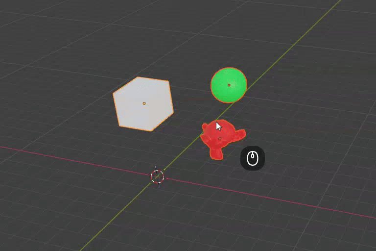
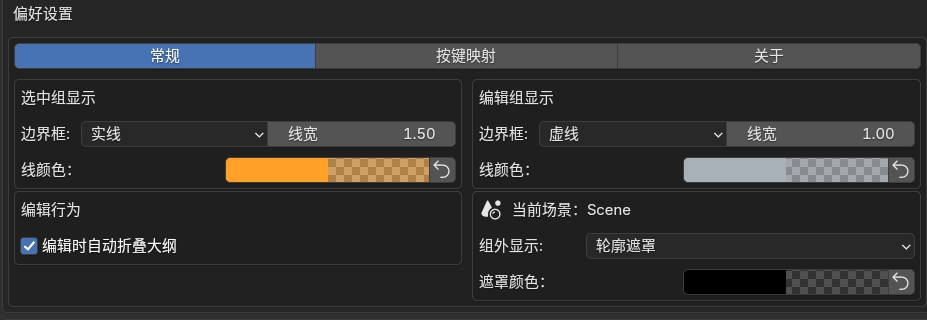
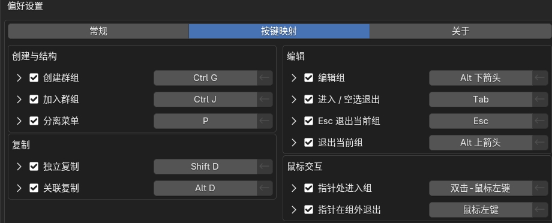

# SketchGroup · Blender 极简打组工具

SketchGroup，无需快捷键即可对集合实例进行快速编辑退出的打组工具。

## 常用

| 操作 | 快捷键 | 说明 |
| --- | --- | --- |
| **创建群组** | **Ctrl+G** | 将选中物体打组 |
| **编辑组** | **双击** / **Tab** | 双击组，或选中组后按 Tab |
| **退出组** | **单击组框外** / **Esc** / **空选 Tab** | Esc 在物体模式下退出；框外单击按位置返回上层或场景 |
| **加入群组** | **Ctrl+J** | 将物体加入组，以活动项原点为组中心 |
| **复制** | **Shift+D** | 独立复制当前层，嵌套子组保持原有关联 |
| **关联复制** | **Alt+D** | 编辑任意一个，其他同源组同步变化 |

支持组嵌套：组内继续打组、双击进入子组，点击子组框外、父组框内可返回父组。

## 分离与解散

组编辑中按 **P**：

| 菜单项 | 效果 |
| --- | --- |
| **选中项** | 将选中物体原位分离到场景 |
| **解散** | 只展开当前层 |
| **解散全部** | 连同嵌套子级一起展开 |

场景中也可选中组，右键 → SketchGroup → 解散。只想修改某一个关联实例时，先独立化。

## 调整原点

| 操作 | 方法 |
| --- | --- |
| **开启／关闭仅影响原点** | **Ctrl+.**（Blender 默认键位） |
| **调整中心** | 开启后用 **G / R / S**，模型保持原位；完成后关闭 |

## 偏好设置

可在插件设置中自定义组边界框和轮廓遮罩的粗细和颜色

