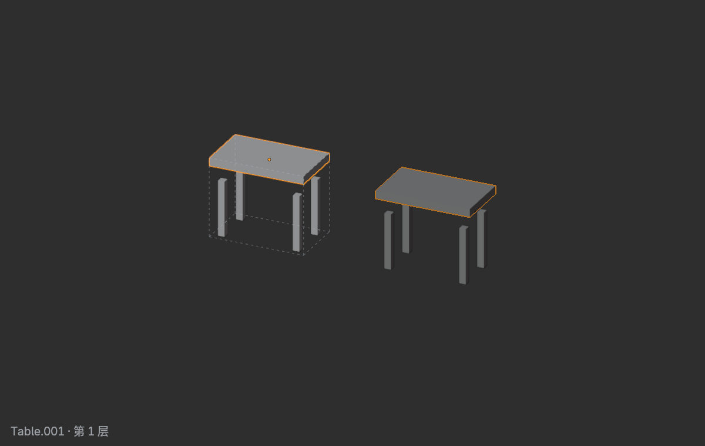

# SketchGroup · Blender 极简打组工具

**双击进入群组，原位编辑，关联副本实时同步。**

用于 Blender 场景搭建，支持组中组、独立／关联复制、加入、分离和解散。

[图文快速上手](docs/USER_GUIDE.zh-CN.md) · [下载](https://github.com/RainskyCG/Blender-SketchGroup/releases)

## 安装

适用于 Blender 5.0+，已验证 Windows / Blender 5.0.1；轮廓遮罩需要 OpenGL。

| 步骤 | 操作 |
| --- | --- |
| **1 · 下载** | 下载 **SketchGroup-v1.0.0.zip**，不用解压 |
| **2 · 安装** | Blender 偏好设置 → 扩展／插件页面右上角菜单 → **从磁盘安装** |
| **3 · 启用** | 选择 ZIP 并启用 SketchGroup |

## 先记住这几个操作

| 操作 | 按键 |
| --- | --- |
| 打组 | Ctrl+G |
| 进入组 | 双击或 Tab |
| 退出组 | Esc、空选 Tab，或单击组框外 |
| 独立复制当前层 | Shift+D |
| 关联复制 | Alt+D |
| 加入组 | Ctrl+J |
| 分离／解散 | 组编辑中按 P |

组内可以继续 Ctrl+G 打组。Shift+D 保留嵌套子组的原有关联；需要单独修改时，右键 → SketchGroup → **独立化**。

完整入门步骤见[图文快速上手](docs/USER_GUIDE.zh-CN.md)。

## 开源

[GPL-3.0-or-later](LICENSE) · [图标来源](assets/icons/SOURCES.md) · [贡献说明](CONTRIBUTING.md) · [构建说明](docs/BUILD.md)

[Rainsky](https://github.com/RainskyCG) · [ArtStation](https://www.artstation.com/rain_sky) · [bilibili](https://space.bilibili.com/26918877)
